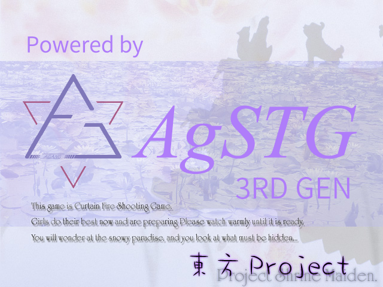
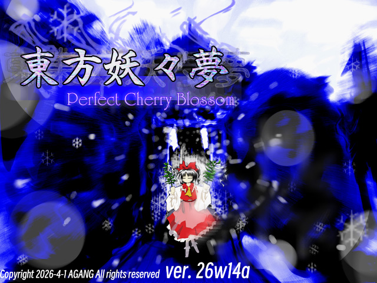
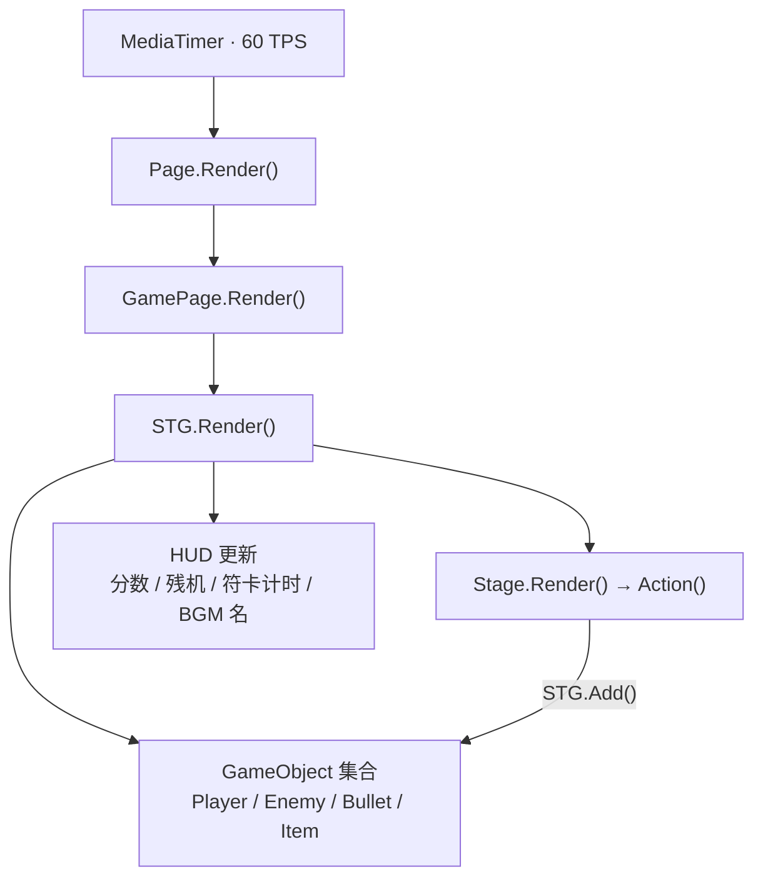

<div align="center">



<h1>AgSTG</h1>

<p><b>可能是最好的 VB.NET 东方弹幕 STG 引擎</b><br>
弹幕、符卡、回放、音频、结算页都已就位 —— 你只需要专注于写关卡。</p>

<p>
  <a href="https://github.com/MC-AGANG/AgSTG/releases/latest"></a>
  <a href="LICENSE"></a>
  
  
  
  <a href="https://github.com/MC-AGANG/AgSTG/stargazers"></a>
</p>

<p>
  <a href="#-这是什么">简介</a> ·
  <a href="#-示例预览">预览</a> ·
  <a href="#-快速开始">快速开始</a> ·
  <a href="#-操作方式">操作</a> ·
  <a href="#-项目结构">结构</a> ·
  <a href="#-运行原理">原理</a> ·
  <a href="#-5-分钟上手">上手</a> ·
  <a href="#-api-速查">API</a> ·
  <a href="#-常见问题">FAQ</a>
</p>

</div>

## ✨ 这是什么

**AgSTG** 是一个用 **VB.NET + WPF** 从零实现的 2D 弹幕射击（STG）引擎，面向东方 Project 风格的二次创作。它把 STG 里最琐碎的部分都封装好了：

- 自机、敌机、子弹、激光、掉落物、Boss、符卡、对话、粒子、HUD……
- 稳定 60 TPS 的定帧主循环与高精度计时器
- 回放录制与播放、素材内嵌、BASS 音频
- 页面与控件框架（标题页、暂停页、结算页、失败页）

项目自带一个完整的示例游戏：**东方妖妖梦 愚人节版**，6 面全流程，包含道中、Boss、符卡、对话与结算。克隆下来按 <kbd>F5</kbd> 就能玩，不需要解压资源文件，也不需要手动设置启动项目。

> [!NOTE]
> 受 Visual Studio 限制，项目已全面迁移到 **.NET 10**，换来的是明显的流畅度提升。  
> 截至 **2026 年 4 月 21 日**，历时 4 年的研发让引擎进入「完全体」，后续工作以优化与打磨为主。

| 项目 | 信息 |
| :-- | :-- |
| 语言 / 框架 | VB.NET · .NET 10 · WPF |
| 画面规格 | 窗口 640 × 480 · 弹幕区 384 × 448 · 60 TPS 定帧 |
| 运行平台 | Windows x64（另有 `Embedded` 嵌入式分支） |
| 许可证 | MIT |
| 最新版本 | [26w17a](https://github.com/MC-AGANG/AgSTG/releases/latest)（周更版本号 `26wxx`） |
| 示例游戏 | 东方妖妖梦 愚人节版 · 6 面完整流程 |

> 为什么是 VB？.NET 能做的事，VB.NET 都能做，而作者恰好写了 8 年 VB。  
> 顺便说一句：他终于学会 Git 了，所以现在这个仓库克隆下来就能直接跑。

## 🎮 示例预览

<p align="center">
  
  <br>
  <sub>示例游戏「东方妖妖梦 愚人节版」· 6 面完整流程 · 标题 / 暂停 / 通关 / 失败页一应俱全</sub>
</p>

示例项目最初是东方鬼形兽 6 面，后来整体替换为妖妖梦愚人节版，用来展示更多引擎能力：

- **6 个关卡脚本**：道中、Boss、符卡与关卡背景动画
- **对话系统**：CSV 剧本 + 双方立绘 + 自动 / 按键推进
- **回放系统**：完整录制与播放，支持 4 倍速快进
- **完整流程**：标题页 → 游戏 → 暂停 / 结算 / 失败 → 回放

> [!NOTE]
> 示例中的美术、音频与文本素材仅用于演示引擎能力，版权归原作者所有。

## 🚀 快速开始

### 环境要求

| 依赖 | 版本 / 说明 |
| :-- | :-- |
| 操作系统 | Windows 10 / 11（x64） |
| 运行时 | [.NET 10 SDK](https://dotnet.microsoft.com/download) |
| IDE | Visual Studio 2026（解决方案版本 18）或更高，需勾选「.NET 桌面开发」 |
| 其他 | 无。素材已编译进 dll，`bass.dll` 随生成目录输出 |

### 用 Visual Studio 跑起来

1. 克隆仓库（默认分支为 `Windows`）：

   ```powershell
   git clone https://github.com/MC-AGANG/AgSTG.git
   ```

2. 打开 `AgSTG.sln`，把 **TH07** 设为启动项目。
3. 按 <kbd>F5</kbd>，等加载页过去就能玩。

### 用命令行跑起来

```powershell
git clone https://github.com/MC-AGANG/AgSTG.git
cd AgSTG
dotnet build AgSTG.sln -c Release
.\TH07\bin\Release\net10.0-windows7.0\TH07.exe
```

### 只想玩示例？

到 [Releases](https://github.com/MC-AGANG/AgSTG/releases/latest) 下载最新的 `26wxx.7z`，解压即玩，不用配置任何开发环境。

> [!IMPORTANT]
> 默认分支是 `Windows`。需要嵌入式平台支持，请切换到 `Embedded` 分支；Release 中只发布 Windows 版本。

## 🎯 操作方式

| 按键 | 功能 |
| :-- | :-- |
| <kbd>↑</kbd> <kbd>↓</kbd> <kbd>←</kbd> <kbd>→</kbd> | 移动 |
| <kbd>Z</kbd> | 射击（按住连发） |
| <kbd>X</kbd> | 使用符卡（Bomb） |
| <kbd>Shift</kbd> | 低速移动，显示判定点 |
| <kbd>Esc</kbd> | 暂停 |
| <kbd>F11</kbd> | 全屏 / 窗口切换 |
| <kbd>Ctrl</kbd> | 回放模式下 4 倍速快进 |

## 🧩 项目结构

```text
AgSTG/
├─ AgSTG.sln                 解决方案（12 个项目）
├─ AgSTG.Core/               与 UI 无关的核心：定时器、按键、回放
├─ AgSTG/                    引擎本体：STG、自机、敌机、子弹、符卡…
├─ AgSTG.Controls/           Page / Control / Button / GroupBox
├─ ResourcePack/             通用素材（图片、音效）
├─ ResourcePack.TH07/        妖妖梦示例素材（立绘、Boss、BGM、剧本）
├─ Stage1/ … Stage6/         六个示例关卡
├─ TH07/                     示例游戏主程序
└─ dll/                      ManagedBass、wpfpslib
```

| 项目 | 目标框架 | 职责 |
| :-- | :-- | :-- |
| `AgSTG.Core` | net10.0 | 高精度定时器 `MediaTimer`、按键状态 `KeyState`、回放数据 `Replay` / `ReplayFile` |
| `AgSTG` | net10.0-windows7.0 | 引擎主体：`STG` 场景、`GameObject`、`Player`、`Enemy`、`Bullet`、`SpellCard`、`Stage`、`Item`、粒子与 HUD |
| `AgSTG.Controls` | net10.0-windows | 页面与控件框架：`Page`、`Control`、`Button`、`GroupBox`、`GamePage` |
| `ResourcePack` | net10.0-windows7.0 | 通用素材库：`Textures` / `Sounds`，素材编译进 dll |
| `ResourcePack.TH07` | net10.0-windows7.0 | 妖妖梦素材：`Textures` / `Sounds` / `Texts` |
| `Stage1` … `Stage6` | net10.0-windows(7.0) | 六面关卡脚本与背景动画 |
| `TH07` | net10.0-windows7.0 | 示例游戏：标题、暂停、通关、失败、启动器 |
| `dll` | — | 本地依赖：ManagedBass（BASS 音频）、wpfpslib（着色器特效） |

## 🧠 运行原理



- **坐标**：原点在弹幕区左上角，X 向右、Y 向下；弹幕区 384 × 448，画布 640 × 480，右侧是状态栏。
- **方向**：0° 朝上，顺时针递增（90° 向右、180° 向下、270° 向左）。
- **时间**：一切以「帧」为单位，默认 60 帧 / 秒。`If Ticks = 120` 就是第 2 秒。
- **随机**：关卡开始时按时间播种；回放时改用记录下来的种子，因此每次都能完全复现。
- **实体**：创建后立即出现在画面上，但只有被加入 `Objects` 才会执行脚本；遍历中新增的实体会先进入 `Objects_Add`，在帧末统一并入，避免集合被修改。

### 一帧里发生了什么

1. `MediaTimer` 每 1/60 秒触发一次，在独立线程上依次调用注册的 `Act`；
2. `Page.Render()` → `GamePage.Render()` → `STG.Render()`；
3. 遍历 `Objects`，让每个实体执行 `Render()` 与 `Move()`，并处理待添加 / 待移除；
4. `Stage.Action()` 按 `Ticks` 生成敌机与子弹；
5. 更新 HUD：分数、残机、符卡倒计时、Boss 名与 BGM 名。

## ⚡ 5 分钟上手

### 第一步：写一个关卡

继承 `Stage`，在 `Action()` 里用 `Ticks` 编排时间轴。下面就是一个能跑的最小关卡：

```vb
Imports AgSTG

Public Class MyStage
    Inherits Stage

    Public Sub New(difficulty As Difficulty)
        MyBase.New(difficulty)
    End Sub

    Public Overrides Sub Initialize()
        Reset()
    End Sub

    Public Overrides Sub Reset()
        MyBase.Reset()
        Background = New MyStageBackground()   ' 换成自己的 UserControl；没有就先删掉这行
    End Sub

    Public Overrides Sub Action()
        If Ticks = 0 Then Showmusic("My Stage Theme")

        ' 第 2～5 秒：每 10 帧放一只小妖精
        If Ticks >= 120 AndAlso Ticks <= 300 AndAlso Ticks Mod 10 = 0 Then
            STG.Add(New Enemy(EnemyType.小妖精, 0, 192, -16, 30, "001", 600, 1.5, 180) With {
                .Tag = 1,
                .Act = AddressOf .FairyAct
            })
        End If

        ' 第 8 秒：Boss 入场
        If Ticks = 480 Then
            STG.Add(New Enemy.Boss(0, 192, -50) With {
                .Init = AddressOf .BossInit,
                .Act = AddressOf .BossAct
            })
        End If
    End Sub
End Class
```

> `AddressOf .FairyAct` 这种写法依赖 VB 的扩展方法成员绑定：扩展方法 `FairyAct(e As Enemy)` 可以直接当作敌机实例的零参方法使用，正好塞进 `Act`（`Action`）。示例关卡里到处都是这种写法。

### 第二步：给敌机写弹幕

脚本就是「每帧调用一次的方法」。用 `<Extension>` 写在模块里，就能挂到敌机身上：

```vb
Imports System.Runtime.CompilerServices
Imports AgSTG

Module MyEnemyScripts
    ''' <summary>小妖精的行动脚本：每一帧调用一次</summary>
    <Extension>
    Public Sub FairyAct(e As Enemy)
        With e
            If .Ticks = 60 Then
                .Speed = 0
            ElseIf .Ticks = 90 Then
                For i = 0 To 11
                    STG.Add(New Bullet(BulletType.环弹, BulletColor.蓝, .X, .Y, 1.5, i * 30, 0))
                Next
            ElseIf .Ticks = 150 Then
                .Speed = 1
                .Direction = 180
            End If
        End With
    End Sub
End Module
```

> `New Bullet` 的 7 参数重载是「指定方向」：第 6 位是绝对角度，第 7 位是随机摆动幅度。想让子弹从敌机位置瞄准自机，用 5 参数或 6 参数重载即可。

### 第三步：加一个带符卡的 Boss

Boss 用 `Init` 准备贴图与符卡表，用 `Act` 控制入场和开战：

```vb
Imports System.Runtime.CompilerServices
Imports AgSTG
Imports ResourcePack.TH07

Module MyBossScripts
    <Extension>
    Public Sub BossInit(e As Enemy.Boss)
        With e
            For i = 0 To 4
                .NormalTextures.Add(Textures.boss(0, i))
            Next
            .SpellCards.Add(New MySpell(e))
            .Layer3.Fill = Textures.boss(0, 0)
        End With
    End Sub

    <Extension>
    Public Sub BossAct(e As Enemy.Boss)
        With e
            If .Ticks = 0 Then .MoveToCenter(60)
            If .Ticks = 65 Then
                STG.NameArea.Initialize("My Boss", 1)   ' 名字 + 符卡总数
                .NextSpell()
            End If
        End With
    End Sub
End Module

Public Class MySpell
    Inherits SpellCard

    Public Sub New(owner As Enemy.Boss)
        MyBase.New(owner)
        Type = SpellType.Life
        HaveUsual = True
        UsualHP = 1200 : UsualTime = 1200
        SpellHP = 1500 : SpellTime = 2400
        Score = 1000000
        Items = "000000000011111111114"
        SpellName = "「Sample Sign」"
    End Sub

    Public Overrides Sub Render()
        MyBase.Render()
        If AtSpell AndAlso Ticks Mod 12 = 0 Then
            For i = 0 To 15
                STG.Add(New Bullet(BulletType.小玉, BulletColor.红, Owner.X, Owner.Y, 2, i * 22.5 + Ticks, 0))
            Next
        End If
    End Sub
End Class
```

- `SpellType.None`：只有非符
- `SpellType.Life`：血量符卡，打完血进入下一张
- `SpellType.Time`：时符，时间到自动结束
- `HaveUsual = True` 会在符卡前插入一段非符

### 第四步：注册关卡

```vb
' 顺序即游戏顺序
STG.Stages.Add(New MyStage(Difficulty.Normal))
```

剩下的工作是把 `GamePage` 放进窗口、启动 60 TPS 的 `MediaTimer`、每帧刷新 `KeyState` —— 这三件事在 `TH07\MainWindow.xaml.vb` 的 `Start()` 里有完整示例，照抄即可。

## 📚 API 速查

### `STG`：全局状态与工具

| 成员 | 说明 |
| :-- | :-- |
| `STG.Add(obj)` | 添加实体；在帧末统一并入，遍历中调用也安全 |
| `STG.Objects` | 当前帧所有实体 |
| `STG.Player` | 自机实例 |
| `STG.SearchEnemy(Tag)` / `SearchBullet(Tag)` | 按 `Tag` 查找敌机 / 子弹 |
| `STG.ClearBullet()` | 全屏消弹（Boss 击破、放 Bomb 时常用） |
| `STG.Score` / `STG.HiScore` | 当前分数 / 最高分 |
| `STG.Life` / `STG.LifePiece` | 残机 / 残机碎片 |
| `STG.Spell` / `STG.SpellPiece` | 符卡 / 符卡碎片 |
| `STG.Power` / `STG.PointValue` / `STG.Graze` | 火力 / 最大得点 / 擦弹数 |
| `STG.CurrentStage` / `STG.Stages` | 当前关卡索引 / 关卡列表 |
| `STG.NextStage()` | 进入下一关，并记录本关的回放数据 |
| `STG.Reset()` | 重置整局游戏 |
| `STG.UpdateTime(n)` | 刷新符卡倒计时 HUD |
| `STG.ShakeFrame` | 屏幕震动剩余帧数 |
| `STG.ReplayMode` | 是否处于回放模式 |

### `GameObject`：一切实体的基类

| 成员 | 说明 |
| :-- | :-- |
| `X` / `Y` | 坐标，原点在弹幕区左上角 |
| `Ticks` | 已存在帧数：创建时为 -1，第一次 `Render()` 时变为 0 |
| `HitboxSize` | 碰撞半径 |
| `Tag` | 任意标记，供查找与分支使用 |
| `IsEnabled` | 是否参与碰撞与交互 |
| `Opacity` | 不透明度 |
| `Layer1` / `Layer2` / `Layer3` | 三层贴图，可分别旋转、缩放、平移 |
| `SetSize(w, h, hitbox)` | 设置尺寸与判定半径 |
| `Clear()` | 从游戏中移除自己 |
| `IsHit(other)` | 圆形碰撞检测 |

### `Enemy`：敌机

```vb
New Enemy(type, color, x, y, hp, dropItems, life, speed:=0, direction:=0, defence:=0)
```

| 参数 | 说明 |
| :-- | :-- |
| `type` | 外观：`阴阳玉` / `小妖精` / `小蝴蝶` / `中蝴蝶` / `大蝴蝶` / `幽灵` / `乌鸦` |
| `color` | 细分配色编号 |
| `hp` | 血量 |
| `defence` | 防御 0～1，按比例减伤 |
| `dropItems` | 掉落物字符串，每一位对应一种掉落物 |
| `life` | 最大存在帧数 |
| `speed` / `direction` | 移动速度 / 角度（0° 朝上，顺时针） |

`dropItems` 的位含义：`0` P 点、`1` 蓝点、`2` 信仰点、`3` 残机、`4` 残机碎片、`5` 符卡（B）、`6` 符卡碎片。例如 `"0011"` 表示掉 2 个 P 点和 2 个蓝点。

### `Bullet`：子弹与激光

| 写法 | 说明 |
| :-- | :-- |
| `New Bullet(type, color, x, y, speed)` | 自机狙，朝自机飞 |
| `New Bullet(type, color, x, y, speed, delta)` | 自机狙 + 角度偏移 `delta` |
| `New Bullet(type, color, x, y, speed, direction, 0)` | 指定方向，`direction` 为绝对角度，末位为随机摆动幅度 |
| `New Bullet.Laser(color, x, y, direction, width, length, life)` | 激光：30 帧预警 → 展开 → 持续 `life` 帧 |

| 属性 | 说明 |
| :-- | :-- |
| `.Act` | 每帧脚本，用 `AddressOf .SomeExtension` 挂载 |
| `.Breakable` | 能否被消弹，默认 `True` |
| `.SoundEffect` | 生成音效，设为 `-1` 静音 |
| `.Speed` / `.Direction` | 速度 / 角度，可在脚本里逐帧修改 |
| `.Grazed` | 是否已被擦弹 |

### `SpellCard`：Boss 符卡

| 属性 | 说明 |
| :-- | :-- |
| `Type` | `None` 仅非符 / `Life` 血条符卡 / `Time` 时符 |
| `HaveUsual` / `UsualHP` / `UsualTime` | 是否带非符，及非符血量 / 时限 |
| `SpellHP` / `SpellTime` | 符卡血量 / 时限（帧） |
| `Score` | 击破奖励分 |
| `Items` | 击破掉落物，格式同敌机 |
| `SpellName` | 符卡名，宣言时显示 |
| `StageCount` / `StagePercent` | 多段血条的段数与比例 |
| `Render()` | 重写它来写弹幕，记得先调用 `MyBase.Render()` |

### `Stage`：关卡

| 成员 | 说明 |
| :-- | :-- |
| `Initialize()` / `Action()` | 必须重写：初始化 / 每帧脚本 |
| `Ticks` | 关卡已运行帧数 |
| `Background` | 背景 `UserControl`，随关卡加载 / 卸载 |
| `Difficulty` | 难度枚举 |
| `Title` + `ShowTitle()` | 关卡标题图与淡入淡出 |
| `Showmusic(name)` | 显示滚动的 BGM 名 |
| `Clear()` | 通过关卡并进入下一关 |

### `Textures` / `Sounds`：素材

| 成员 | 说明 |
| :-- | :-- |
| `Textures.bullet(type, color)` | 子弹贴图 |
| `Textures.enemy(type, color, frame)` | 敌机贴图 |
| `Textures.number(style, digit)` | 数字贴图，HUD 用 |
| `Textures.player_hitbox` | 判定点贴图 |
| `Sounds.PlaySound(id, volume:=1)` | 播放音效，可指定音量 |
| `Sounds.StopSound(id)` | 停止音效 / BGM |
| `Sounds.mu01` … `mu13` | 示例 BGM |
| `Sounds.tan00` / `graze` / `pldead00` … | 示例音效 |

<details>
<summary><b>枚举一览（点击展开）</b></summary>

| 枚举 | 取值 |
| :-- | :-- |
| `BulletType` | 激光、鳞弹、环弹、小玉、米弹、苦无、棱弹、札弹、座药、黑心弹、小星弹、星弹、中玉、蝶弹、刀弹、椭弹、心弹、箭头、小光玉、点弹、大玉 |
| `BulletColor` | 灰、暗红、红、紫、品红、深蓝、蓝、青、天蓝、深绿、绿、黄绿、土黄、黄、橙、白 |
| `EnemyType` | 阴阳玉、小妖精、小蝴蝶、中蝴蝶、大蝴蝶、幽灵、乌鸦 |
| `Difficulty` | Easy、Normal、Hard、Lunatic、Override、Extra、Phantasm |
| `SpellType` | None、Life、Time |
| `PlayerType` | 灵梦、魔理沙 |

</details>

## ❓ 常见问题

<details>
<summary><b><code>STG.Add()</code> 和 <code>STG.Objects.Add()</code> 有什么区别？</b></summary>

`STG.Add()` 会把对象放进 `Objects_Add`，在当前帧遍历结束后统一并入 `Objects`，所以在 `For Each` 里加对象也不会抛异常，推荐优先使用。  
`STG.Objects.Add()` 是立即加入，示例里 Boss 入场用了这种写法。两种都能用，只是不要在一帧的遍历中途直接增删 `Objects`。

</details>

<details>
<summary><b>为什么项目固定 x64？</b></summary>

引擎使用的 BASS 原生库 `bass.dll` 是 64 位的，示例工程也按 x64 运行。请使用默认配置，不要把启动项目强制改成 x86。

</details>

<details>
<summary><b>素材在哪里？怎么换成自己的？</b></summary>

所有图片、音频、对话文本都编译进了 dll：`ResourcePack/MyResource.resx` 是通用素材，`ResourcePack.TH07/MyResource.resx` 是示例素材。替换资源后重新生成即可，不需要额外拷贝文件。

</details>

<details>
<summary><b>能改帧率和分辨率吗？</b></summary>

帧率由 `New MediaTimer(60)` 的构造参数决定，改大可以更顺滑，但逻辑都是按 60 帧写的，改之前请确认弹幕速度与时间轴。窗口 640 × 480、弹幕区 384 × 448 写在 XAML 里，改动需要同步调整右侧 HUD 的布局。

</details>

<details>
<summary><b>回放文件为什么这么小？</b></summary>

回放不存画面，只存「每关的随机种子 + 每帧一个字节的按键状态」。播放时用同一个种子重跑关卡，因此文件通常只有几十 KB，却能完整复现一局游戏。

</details>

## 📌 项目状态

| 模块 | 状态 |
| :-- | :-- |
| 核心引擎 | ✅ 完成（2026-04-21） |
| 示例游戏（TH07） | ✅ 6 面完整流程 |
| 回放系统 | ✅ 录制 / 播放 / 快进 |
| 嵌入式支持 | 🧪 `Embedded` 分支 |
| 后续方向 | 🔧 性能优化、开发体验、可视化工具 |

## 🤝 参与贡献

- 发现 bug 或有建议，欢迎提 [Issue](https://github.com/MC-AGANG/AgSTG/issues)。
- 提交 PR 前请确认 `dotnet build AgSTG.sln -c Release` 通过，并尽量让一个 PR 只做一件事。
- 版本号采用「年份 + 周数 + 修订」格式（如 `26w17a`）。

## 📄 许可证与致谢

- 代码以 [MIT License](LICENSE) 开源，Copyright © 2023 [AGANG](https://github.com/MC-AGANG)。
- 示例中的东方 Project 素材（立绘、BGM、文本等）版权归 **上海アリス幻樂団 / ZUN** 及原作者所有，仅用于学习与演示，请勿用于商业用途。
- 音频基于 [BASS](https://www.un4seen.com/)（ManagedBass 封装），商业使用请遵守其授权条款。

---

<div align="center">
  <sub>如果这个项目帮到了你，点一个 ⭐ Star 就是最好的支持。</sub>
</div>
